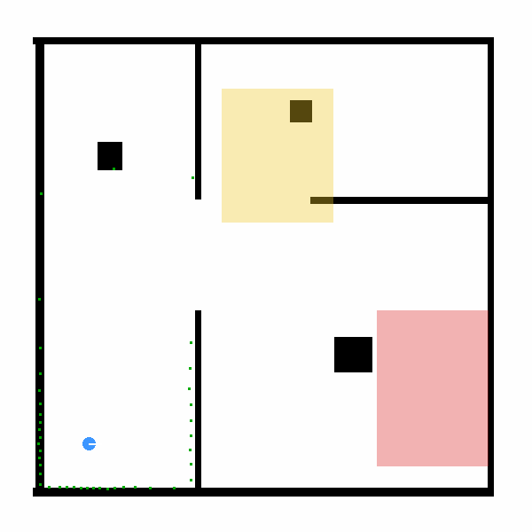

# nav_robot

A small differential-drive robot in Gazebo with a full Nav2 stack: obstacle avoidance, keepout and speed-limit zones, SLAM, a waypoint patrol and a click-to-go web dashboard. Everything is generated from one world definition, so you can change the map in one place.



*A real run: five waypoints, then back to the dock. Blue is the path, green is the lidar, red is the keepout zone, yellow is the slow zone. Source: `scripts/make_demo_gif.py`.*

## What is in it

| Feature | How |
|---|---|
| Robot | diff drive, 360-degree lidar, IMU, EKF on wheel odometry and IMU (`urdf/`, `config/ekf.yaml`) |
| Navigation | Nav2 with MPPI controller, Smac 2D planner, AMCL |
| Safety | `nav2_collision_monitor` stop and slowdown polygons, velocity smoother |
| Zones | keepout mask (no-go) and speed mask (slow) as Nav2 costmap filters |
| Recovery | custom behavior tree: clear costmaps, spin, back up, wait, retry |
| Patrol | `scripts/patrol.py` loops waypoints with `nav2_simple_commander`, then docks |
| Dashboard | `scripts/dashboard.py`, click the map to send a goal |
| Mapping | `slam:=true` runs slam_toolbox instead of AMCL (experimental) |

## Quick start

Needs ROS 2 Humble, Gazebo (`gz sim`), Nav2, `ros_gz`, `robot_localization` and `slam_toolbox`.

```bash
mkdir -p ~/nav_ws/src && cd ~/nav_ws/src
git clone https://github.com/darshmenon/nav_robot
cd .. && colcon build --symlink-install && source install/setup.bash

ros2 launch nav_robot sim.launch.py              # Gazebo with the GUI (headless:=true for none)
ros2 launch nav_robot nav.launch.py rviz:=true   # Nav2 on the prebuilt map
ros2 run nav_robot patrol.py --loops 2           # patrol, then return to the dock
ros2 run nav_robot dashboard.py                  # open http://localhost:8080
ros2 run nav_robot spawn_obstacle.sh -3.0 0.3    # drop an unmapped box in the sim
```

Map while driving with `ros2 launch nav_robot nav.launch.py slam:=true`.

## Zones

`scripts/gen_world.py` writes the world, the map and both masks, so the zones always match the world. Edit `KEEPOUT` and `SLOW` at the top, run it, rebuild.

Checked in the sim:
- A goal inside the keepout zone is refused, and a route to a goal beyond it has no poses in the zone.
- In the slow zone the robot's 95th percentile speed was 0.19 m/s, against 0.50 m/s elsewhere.

## Known limits

- SLAM mode is untested end to end: it comes up and publishes `/map`, but a full mapping run was not scored against the world.
- In SLAM mode the costmaps warn "Filter mask was not received" because the zone filters need a static map. It is harmless.
- DDS discovery is flaky on a heavily loaded machine. If Nav2 does not reach "Managed nodes are active", restart `nav.launch.py`.

## Layout

```
launch/   sim.launch.py, nav.launch.py
config/   nav2_params.yaml, ekf.yaml, slam.yaml, bridge.yaml
urdf/     robot.urdf.xacro
worlds/   office.sdf (generated)
maps/     office, keepout_mask, speed_mask (generated)
scripts/  gen_world.py, patrol.py, dashboard.py, spawn_obstacle.sh, make_demo_gif.py
```

## License

Apache-2.0
